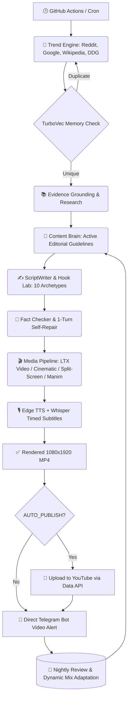

<div align="center">
  

  # 🚀 SensorySlice: Autonomous YouTube Shorts Agent

  **A 100% Free, Fully Autonomous AI Channel Automation Pipeline & Generative Video Studio**

  [](https://github.com/features/actions)
  [](https://huggingface.co/spaces/manojvibranium21/ChatGPT4)
  [](#)
  [](#)
  [](#)

</div>

---

## 🌟 What is this?

**SensorySlice** is a completely autonomous YouTube channel manager and generative AI content pipeline. You set it up once, and it runs autonomously.

Every day, the agent wakes up and:
1. 🧠 **Discovers Trends**: Scours Google Trends, Reddit, Wikipedia, HackerNews, and DuckDuckGo for viral signals.
2. 🕵️‍♂️ **Retention-Engineered Scripting**: Researches evidence and writes high-retention 35-45s scripts with infinity loopbacks.
3. 🔬 **Fact-Checking & Guardrails**: Analyzes claims against scientific truth and triggers a 1-turn automated self-repair loop on contested claims.
4. 🎬 **Generative Video & Media**: Generates procedural graphics, Pexels video B-roll, or AI-synthesized videos using **Lightricks LTX foundation models**.
5. 🎙️ **Synchronized Voices & Word Captions**: Generates Edge Neural TTS voiceovers with Whisper-timed, highlighted karaoke subtitles.
6. 🚀 **Uploads to YouTube**: Automatically uploads to your YouTube channel via the YouTube Data API.
7. 📲 **Instant Alerts**: Sends preview cards and the final `.mp4` straight to your Telegram bot.
8. 🔄 **Closed-Loop Self-Improvement**: Runs a nightly daily review, analyzes retention metrics, and injects lessons directly into future prompts.

**Best of all? It costs exactly $0.00 to run.**

---

## 🎬 Live Hugging Face Video Studio

We have deployed a live, zero-GPU AI video generation studio directly on Hugging Face Spaces:

👉 **[Launch LTX Video Studio](https://huggingface.co/spaces/manojvibranium21/ChatGPT4)**

* **✨ Text-to-Video**: High-speed, high-definition video generation from descriptive prompts (~10–20s).
* **🖼️ Image-to-Video**: Animate any uploaded static artwork or avatar with smooth cinematic motion.
* **🔊 LTX-2.5 (Video + Audio)**: Generates video with unified, synchronized sound effects and ambient audio.
* **Zero GPU Hardware Cost**: Runs on free cloud CPU while offloading heavy AI diffusion tasks seamlessly through Lightricks' foundation infrastructure.

### Python Code Example:
```python
from backend.services.ltx_service import LTXVideoService

service = LTXVideoService()

# Generate video from text
result = service.generate_text_to_video(
    prompt="A neon cyberpunk hovercar flying through rain at night",
    output_path="exports/cyberpunk.mp4"
)
print("Video saved to:", result["video_path"])
```

---

## 🔄 Architecture & Intelligence Loop



---

## ✨ Core Features

- 🎬 **Integrated LTX Generative Video**: Direct integration with Lightricks LTX models via `gradio_client` (`LTXVideoService`), allowing programmatic video synthesis without local GPUs.
- 🔄 **Closed-Loop Self-Improvement (Content Brain)**:
  - Nightly self-review evaluates what worked, what failed, and strategy changes.
  - Active editorial rules are stored in memory and injected via `content_brain.get_active_editorial_guidelines()` into `ScriptWriterAgent` and `HookLab`.
- 🛡️ **Indestructible Multi-Provider LLM Cascade**:
  - `Gemini -> OpenRouter -> NVIDIA NIM -> Groq -> Local Ollama -> Offline Rule-Based Generator`.
- 🎯 **Hook Lab (10 Psychological Archetypes)**:
  - Generates and scores candidate hooks on curiosity, surprise, emotional impact, clarity, novelty, and retention.
- 🎭 **Pluggable Visual Render Pipelines**:
  1. `LTXVideoStudio`: Generative AI text-to-video and audio-video synthesis.
  2. `BrainrotPipeline`: Viral split-screen gameplay (Minecraft / GTA V).
  3. `CinematicPipeline`: Documentary style with letterboxing and color-grading.
  4. `ManimPipeline`: Programmatic math and code vector animations (3Blue1Brown style).
  5. `HyperframesPipeline`: HTML/CSS animated web scenes.
  6. `CartoonPipeline`: 3D procedural cartoon explainer animations.
- 💾 **Semantic Deduplication**: Uses `TurboVec` memory embeddings to mathematically prevent generating duplicate topics.
- 🧪 **100% Hermetic Test Suite**: Includes `tests/conftest.py` with offline network mocks to ensure zero API quota exhaustion and rapid test execution.

---

## 📁 Repository Structure

```text
├── app.py                         # CLI entrypoint
├── requirements.txt               # Dependencies
├── .gsd/                          # GSD milestone specifications, roadmap, and state
├── backend/
│   ├── core/                      # Config, Database, Jobs, and Orchestrator
│   ├── agents/                    # ScriptWriter, FactChecker, TrendScout, Publisher
│   ├── creative/                  # CreativeDirector, HookLab, StoryEngine, ViewerSimulator
│   ├── services/                  # LTX Video, YouTube, Telegram, FFmpeg, Whisper
│   ├── learning/                  # ContentBrain, DailyReview, CommentEngine
│   └── memory/                    # TurboVec vector embeddings & SQLite persistence
├── spaces/
│   └── ltx_video_space/           # Live Hugging Face Space application (Gradio 5.20)
├── scripts/
│   ├── test_ltx_video.py          # LTX Video Generation test runner
│   └── deploy_ltx_space.py        # Hugging Face Spaces deployment tool
├── tests/                         # Complete Pytest test suite (33/33 passing)
│   ├── conftest.py                # Hermetic LLM & YouTube mocks
│   ├── test_agents.py
│   ├── test_api.py
│   ├── test_brain.py
│   ├── test_creative.py
│   ├── test_database.py
│   ├── test_intelligence.py
│   └── test_services.py
└── credentials/                   # Google OAuth credentials (git-ignored)
```

---

## 🚀 Quick Start

### 1. Installation
```bash
git clone https://github.com/manojvenaram/agent-automation.git
cd agent-automation
pip install -r requirements.txt
```

### 2. Configure Environment
Copy `.env.example` to `.env` and add your free keys:
```env
GEMINI_API_KEY=your_key_here
HF_API_KEY=your_huggingface_token
TELEGRAM_BOT_TOKEN=your_telegram_bot_token
TELEGRAM_CHAT_ID=your_chat_id
```

### 3. Run the Test Suite
Verify that all 33 unit and integration tests pass:
```bash
pytest
```

### 4. Generate Your First Video
```bash
# Test the LTX Video generator
python scripts/test_ltx_video.py

# Or run the autonomous pipeline
python app.py run-agent
```

---

## 📊 GSD Roadmap & Milestone Status

* **Phase 1: Core Media Pipeline** — ✅ Complete (Audio, Subtitles, FFmpeg, Pipelines)
* **Phase 2: Content Intelligence & Closed Loop** — ✅ Complete (Multi-source trends, Fact Checker, Content Brain memory injection)
* **Phase 3: System Stability & Test Hardening** — ✅ Complete (Hermetic testing, 33/33 tests passing)
* **Phase 4: Autonomous Operations & Publishing** — 🔄 Ready (Telegram mobile approvals, YouTube comment synthesis)

---

<div align="center">
  <i>Built with ❤️ by <b>Manoj Venaram</b>.</i>
</div>
